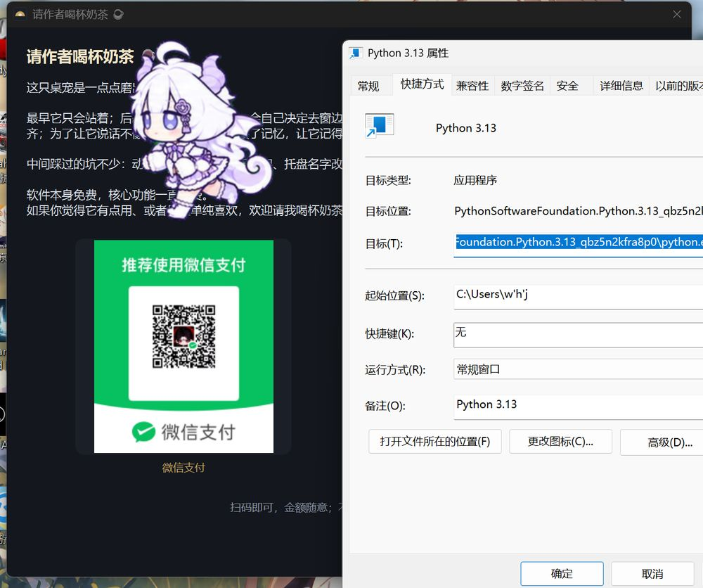

# FirmamentPet

一只住在你桌面上的桌宠：会自己走动、会累、会跟你说话，也能陪你盯盘。


## 它是什么

FirmamentPet 是一个 Windows 桌面宠物客户端。它不是「静态贴图 + 定时换帧」，而是有一套完整的
行为循环：体力、情绪、随机走动、跟随、主动说话，以及可以接入你自己大模型的 AI 对话。

核心功能一直免费，不需要账号，不联网也能用。

## 主要特性

| 能力 | 说明 |
|---|---|
| **形象系统** | 自带 9 个形象；支持从 petdex 链接一键导入，也支持本地 zip 安装 |
| **走位** | 固定不动 / 沿屏幕边缘 / 全屏乱走，带物理抛掷回弹 |
| **体力与休息** | 满体力约走 50 秒，站一会儿回满；累了会自己坐下歇着 |
| **互动** | 单击打招呼、双击放动作、拖拽扔出去、右键菜单喂食与状态 |
| **AI 对话** | 接入任意 OpenAI 兼容接口；带人设、短期记忆、可选的屏幕感知 |
| **主动说话** | 可设间隔与静默时段（默认 23:00–08:00 不打扰） |
| **AI 行为** | 让模型自己决定「坐下 / 打盹 / 走过来」，带台词 |
| **看盘 HUD** | 高级看盘版解锁实时指数显示与秒级周期 |

## 快速开始

1. 到 [Releases](../../releases) 下载最新 `FirmamentPet-vX.Y.zip`；
2. 解压后把 `FirmamentPet.exe` 与 `default_skins\` 放在**同一目录**；
3. 双击运行。首次启动会把 9 个自带形象装到
   `%APPDATA%\FirmamentPet\skins\`。

> 系统要求：Windows 10 / 11（64 位）。**不支持 Linux / macOS**。

## 添加形象

打开 <https://petdex.dev/>，复制形象详情页链接 →
右键桌宠 →「切换形象…」→「从链接导入…」→ 粘贴 → 等几秒即可。

也支持「安装形象包(zip)」，以及在选择窗口里搜索、改名、删除。

## 接入自己的 AI（可选）

右键 →「AI 设置」：

| 项 | 示例 |
|---|---|
| 接口地址 | `https://api.openai.com/v1`（任意 OpenAI 兼容网关） |
| 模型 | `gpt-4o-mini` 等 |
| API Key | 你自己的 key |

配置只写在本机 `%APPDATA%\FirmamentPet\ai_ayaka.json`，不会上传。

不配置也能用：说话走本地台词库，动作走本地策略，只是不会「看场合说话」。



## 高级看盘版

免费版可以正常养、正常互动，但**不显示实时指数**。
高级看盘版解锁指数 HUD 与秒级刷新。

激活码获取方式见 `docs/使用说明.md` 的「高级看盘版（VIP）激活」一节。

## 目录结构（发行包）

```
FirmamentPet.exe        主程序
default_skins\          9 个自带形象（首次启动自动安装）
firmamentpet.ico        图标
使用说明.html/.txt/.md   使用说明
清理旧托盘缓存.cmd        从旧版本升级后清理通知区残留
```

## 常见问题

**Q：通知区显示旧名字？**
那是 Windows 按 exe 路径缓存的托盘条目，双击 `清理旧托盘缓存.cmd` 即可清掉。

**Q：双击没反应 / 闪退？**
确认 `default_skins` 和 exe 在同一目录；看 `%TEMP%\ayaka_crash.log`。

**Q：会收集什么数据？**
不收集。只有在你开启「看见屏幕」时才会截图，且**只发给你自己配置的接口**。

## 支持作者

软件免费，核心功能一直免费。
如果它对你有点用，可以在菜单里「请作者喝杯奶茶」，完全自愿，不打赏也一样用。


## 致谢与声明

- 形象素材来自社区站点 [petdex.dev](https://petdex.dev/)，版权归各自作者所有；
  本仓库不分发原始素材，程序只做本地播放。
- 本项目与米哈游 / HoYoverse 等无关，不含任何官方素材的再分发。
- 仓库内**不包含**可执行文件与形象资源，发行版请从 Releases 获取。

## 文档

- [使用说明（Markdown）](docs/使用说明.md)
- [使用说明（网页版）](docs/使用说明.html)
